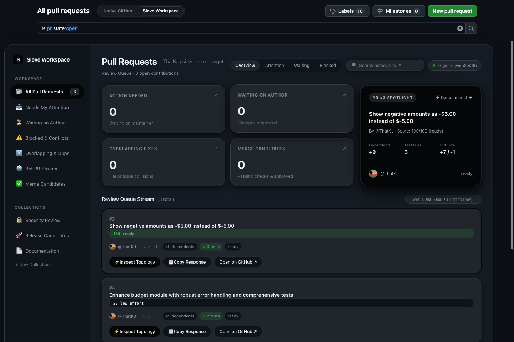

# Sieve

**GitHub, redesigned for maintainers.**

Sieve is an open-source maintainer workspace for GitHub. It checks what a pull request *claims* against what it actually *contains*, maps which parts of the repository the change can affect, and gives you an evidence-backed brief before you spend time reviewing. A deterministic engine produces the facts; an optional Gemma 4 multimodal model interprets the architecture around them, and everything it says is labelled as model output.

It runs locally: a standard-library Python engine plus a Chrome extension that adds a workspace inside GitHub's own pull request pages. Sieve never writes to GitHub.



*The Sieve Workspace on a repository's pull requests page, with the Native GitHub / Sieve Workspace switcher next to the heading.*

---

## Why

Maintainers are receiving more pull requests that look polished and do little, or that quietly break something two files away. In an October 2026 [Linux Foundation survey](https://www.linuxfoundation.org/press/new-lf-research-survey-shows-generative-ai-cuts-open-source-coding-time-in-half-but-25-of-incoming-pull-requests-are-considered-ai-slop), maintainers estimated about a quarter of incoming PRs are low-effort "slop". Today's defences either close the door on all outside contributors or auto-close on metadata without reading the change. Sources and caveats are in [`research/customer-pain.md`](research/customer-pain.md).

Sieve takes a different approach: read the repository, verify the claims, show the evidence, and leave the decision to the maintainer.

## How it works

```
GitHub pull request
  → deterministic analysis: claims vs diff, linked issue, tests, imports (Python ast, JS/TS)
  → impact graph: changed files → direct and indirect dependents → related tests
  → optional Gemma 4: graph image + structured evidence in one multimodal request
  → grounded brief: verified facts and model hypotheses shown separately
```

## Features

### Implemented and covered by tests

- **Claim verification.** Linked issue exists and is open; claimed tests are in the diff; files named in the description exist; new imports resolve to real modules; PR template and checklist; new files placed where similar code lives.
- **Repository Atlas.** File-level import graph from a repository snapshot: Python via `ast`, JS/TS via import statements. Every edge records the import line that justifies it.
- **PR impact and regression radar.** Direct and indirect dependents, related tests, and risks such as a function removed while another file still imports it, deleted files still imported, or config and migration changes.
- **Verification plan.** Concrete next steps, such as the exact `pytest` command for affected tests. Sieve recommends; it never runs them.
- **Confidence ledger.** Every finding is labelled *repository*, *GitHub data* or *model*, with an explicit list of what was not verified.
- **Review queue.** Open PRs ranked and classified by the engine (action needed by you, needs attention, blocked, merge candidate, bot stream), with cross-PR file collisions.
- **Gemma 4 visual intelligence.** The extension renders the blast-radius graph to PNG; the engine sends it with structured AST evidence to `gemma-4-26b-a4b-it` in a single request. Citations are checked against that evidence, and follow-up chat is bound to the PR's head commit. API calls are mocked in tests.
- **Local relevance check (optional).** A bounded, schema-validated question to a local Ollama model: does the diff implement the linked issue?

### Implemented, verified manually or partially

- **Chrome extension (Manifest V3):** command center on `/pulls`, Native/Sieve view switcher, centered PR intelligence workspace, an activation sequence driven by real initialization state, and a popup with connection status. Automated checks cover the manifest, JavaScript syntax, and 15 component tests covering route detection, lifecycle normalization, custom collections, blast-radius sorting, and activation contracts. The UI was exercised against the live engine through a dev harness and on real GitHub.
- **Web app** served by the engine at `http://127.0.0.1:8787`.

### In progress

- Three-tier evidence classes for Gemma output (`direct_pr_evidence`, `repo_symbol`, `unverified_hypothesis`).

See [`docs/ROADMAP.md`](docs/ROADMAP.md) for what's next.

## Quick start

**Requirements:** Python 3.10+ (standard library only, nothing to `pip install`) and Chrome. Optional: [Ollama](https://ollama.com), a GitHub token, a Gemma API key.

```bash
git clone https://github.com/ThatKJ/sieve
cd sieve
cp .env.example .env            # optional: add GITHUB_TOKEN and/or GEMMA_API_KEY; .env is git-ignored
ollama pull qwen3.5:9b          # optional: local relevance check
python3 -m sieve --serve        # engine + web app on http://127.0.0.1:8787
```

**Load the extension:**

1. Open `chrome://extensions` and turn on **Developer mode**.
2. Click **Load unpacked** and select the **`extension/`** folder inside the repository (not the repository root).
3. Open any repository's pull requests page, for example https://github.com/ThatKJ/sieve-demo-target/pulls, and choose **Sieve Workspace** in the switcher.

**From the terminal:**

```bash
python3 -m sieve ThatKJ/sieve-demo-target#4             # one PR: findings + draft reply
python3 -m sieve --queue pallets/click                  # rank a repository's open PRs
python3 -m sieve ThatKJ/sieve-demo-target#4 --json --no-model
```

## Configuration

| Variable | Default | Purpose |
|---|---|---|
| `GITHUB_TOKEN` | `gh auth token` if available | Read-only GitHub API access; raises the rate limit from 60 to 5,000 requests/hour |
| `GEMMA_API_KEY` (or `GEMINI_API_KEY`) | unset | Enables Gemma 4 visual intelligence (`gemma-4-26b-a4b-it` via the Gemini API) |
| `SIEVE_MODEL` | `qwen3.5:9b` | Ollama model for the local relevance check |
| `OLLAMA_URL` | `http://localhost:11434` | Ollama endpoint |
| `SIEVE_OFFLINE` | unset | `1` serves from the on-disk cache only (useful for demos) |
| `SIEVE_HOST` | `127.0.0.1` | Bind address; keep it on localhost because the engine has no authentication |

Secrets belong in `.env` or your environment, never in the extension or in Git. More options are in [`docs/DEVELOPMENT.md`](docs/DEVELOPMENT.md).

## Try it on the demo repository

[`ThatKJ/sieve-demo-target`](https://github.com/ThatKJ/sieve-demo-target) is a tiny Python library with two real bugs filed as issues and three pull requests written on purpose:

| PR | What it is | What Sieve finds |
|---|---|---|
| [#3](https://github.com/ThatKJ/sieve-demo-target/pull/3) | A focused fix for issue #1 with a regression test | Ready for review; affected tests listed |
| [#4](https://github.com/ThatKJ/sieve-demo-target/pull/4) | A polished description claiming tests and a fix for #2 | No test files; an import of a module that doesn't exist; two files named that don't exist; `category_totals` renamed while `report.py:3` still imports it |
| [#5](https://github.com/ThatKJ/sieve-demo-target/pull/5) | A one-word README edit with an empty description | Low-effort signals |

## Architecture

```
Chrome extension / web app  ──HTTP──▶  sieve/server.py (127.0.0.1:8787, origin-checked)
                                         ├─ core.py    claim checks, scoring, queue, ledger
                                         ├─ atlas.py   import graph, impact, regression radar
                                         ├─ llm.py     optional local Ollama check
                                         ├─ gemma.py   optional Gemma 4 multimodal analysis
                                         └─ github.py  read-only GitHub client + cache
```

Details, diagrams and the request lifecycle: [`docs/ARCHITECTURE.md`](docs/ARCHITECTURE.md).

## Security and privacy

- **Read-only:** only GET requests to GitHub; nothing comments, approves, merges or closes.
- **No code execution:** contributor code is parsed, never run.
- **Local:** the engine binds to `127.0.0.1`; browser requests must come from localhost or a Chrome extension.
- **Secrets stay on the engine:** tokens and API keys are read from the environment and never sent to the extension.
- **Model output is advisory:** labelled, grounded against evidence, and unable to trigger actions.

Known gaps are disclosed in [SECURITY.md](SECURITY.md#known-gaps), including that the engine does not yet validate the `Host` header. Report vulnerabilities privately as described there.

## Limitations

- Import graphs cover Python and JS/TS only, at file level; dynamic imports and path aliases aren't resolved.
- Tests are never executed; the verification plan only recommends commands.
- Score weights are hand-set heuristics, not trained on labelled data.
- Gemma 4 features need a Gemini API key and network access; grounding checks citations, not the correctness of the model's reasoning.
- No automated browser tests for the extension yet.

Full list: [`docs/known-limitations.md`](docs/known-limitations.md).

## Testing

```bash
python3 -m unittest discover -s tests
```

The suite uses synthetic data and mocked HTTP: no network, GitHub token or API key needed. CI runs it on Python 3.10, 3.12 and 3.13, plus JavaScript syntax and manifest checks ([`.github/workflows/ci.yml`](.github/workflows/ci.yml)).

## Contributing

Contributions are welcome. Start with [CONTRIBUTING.md](CONTRIBUTING.md) and the [Code of Conduct](CODE_OF_CONDUCT.md). Development setup and debugging are in [`docs/DEVELOPMENT.md`](docs/DEVELOPMENT.md).

## AI tools used

Built at the DevF8rge × Hacktoberfest 2026 Hack Day, Bengaluru, whose rules require disclosing AI assistance:

- **Claude Code** (Anthropic, Claude Opus 5.5): research, engine, front ends, tests and documentation.
- **opencode / Gemini**: an intermediate front-end iteration (commit `794aae9`) generated from [`docs/ui-master-prompt.md`](docs/ui-master-prompt.md), later replaced.
- **Runtime models:** `gemma-4-26b-a4b-it` (Gemini API) and `qwen3.5:9b` (Ollama), both optional.

## Credits

[Ollama](https://ollama.com), the Qwen and Gemma model families (see their model cards for licences), design guidance from [dickwu/apple-design-skill](https://github.com/dickwu/apple-design-skill) (no code included), and the MIT licence text from the [SPDX licence list](https://github.com/spdx/license-list-data).

## License

[MIT](LICENSE) © 2026 Kirtan and the Sieve contributors.
