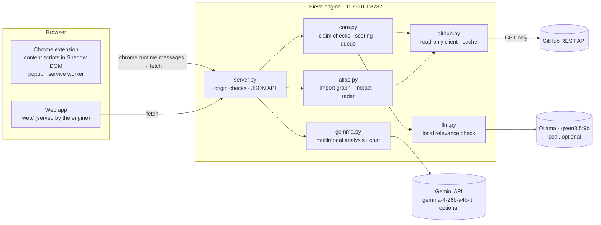
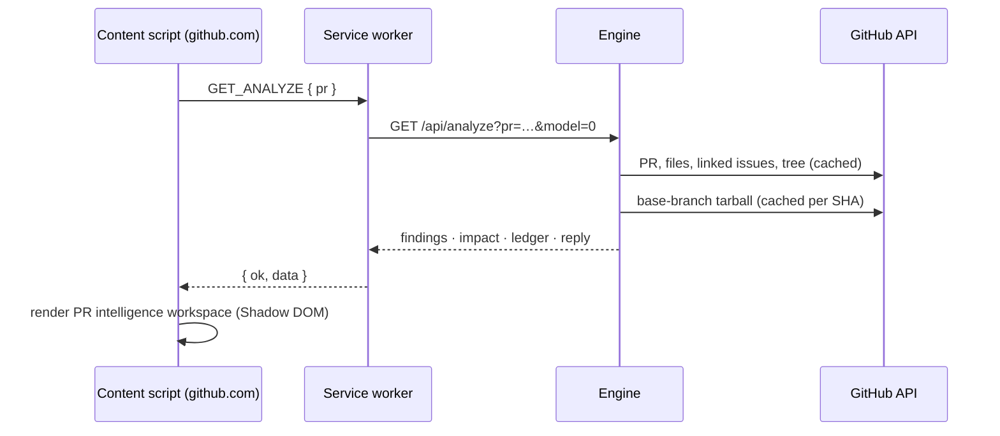
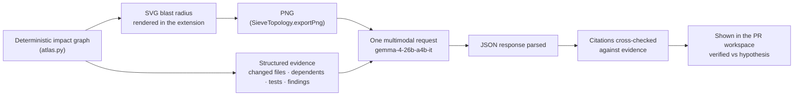

# Architecture

Sieve is a local Python engine (standard library only) plus two front ends that talk to it: a Chrome Manifest V3 extension that lives inside GitHub, and a standalone web app. GitHub stays the source of truth; Sieve only reads from it.



## Components

```
sieve/
  github.py   Read-only GitHub REST client. GET only. On-disk JSON cache (.cache/github, TTL 15 min),
              tarball cache keyed by commit SHA (immutable). Token from GITHUB_TOKEN or `gh auth token`.
  core.py     PR claim checks, scoring, confidence ledger, contributor reply, review queue, commit history signals.
  atlas.py    Repository snapshot → import graph → PR impact, regression radar, verification plan.
  llm.py      One bounded call to a local Ollama model, constrained by a JSON schema, then validated.
  gemma.py    Gemma 4 visual intelligence: PNG validation, structured evidence, grounding, PR-bound chat.
  server.py   http.server on 127.0.0.1: static web/ files plus the JSON API, origin checks, CORS.
  __main__.py CLI: single PR, queue, JSON output, --serve.
extension/    Manifest V3: background.js (service worker), content.js + github-adapter.js, ui/*, popup/.
web/          Standalone app: index.html, app.js, atlas.js (canvas renderer), style.css.
tests/        unittest suites; synthetic data and mocked HTTP, no network or credentials.
```

## API

| Endpoint | Purpose |
|---|---|
| `GET /api/health` | Model name, Ollama and model availability, offline mode, whether a GitHub token is present |
| `GET /api/analyze?pr=<ref>&model=0\|1` | Full PR analysis: findings (each with `source`), score, verdict, impact, commit history, ledger, reply draft |
| `GET /api/atlas?pr=<ref>` or `?repo=<owner/repo>` | Import graph and, for a PR, impact (`marks`, `counts`, `tests`, `risks`, `plan`) |
| `GET /api/queue?repo=<owner/repo>` | Up to 15 open PRs ranked and classified, with a summary |
| `POST /api/gemma/analyze` | Graph PNG (base64) + PR reference or evidence → Gemma 4 analysis with grounding |
| `POST /api/gemma/chat` | Follow-up question about the same PR and head commit |

Errors return `{"error": "…"}` with 400, 403 (origin), 404, 413 (payload or repository too large), 429 (GitHub rate limit), 502/503 (upstream unreachable) or 500. POST bodies are capped at 10 MB.

## Request lifecycle: inspecting a PR from GitHub



The content script mounts its UI inside a Shadow DOM host so GitHub's CSS and Sieve's never mix, and handles GitHub's client-side navigation through `github-adapter.js` (Turbo events plus wrapped `history.pushState`), de-duplicated so one navigation triggers one load.

## Deterministic checks (`core.py`)

| Check | Logic | Source label |
|---|---|---|
| description | Body (minus HTML comments) shorter than 20 characters | GitHub |
| linked_issue | `fixes/closes/resolves #N` or same-repo issue URL; issue fetched to confirm it exists, is an issue and is open | GitHub |
| substance | Whitespace-only diff (all whitespace ignored); tiny docs-only edits | GitHub |
| tests | Description claims tests but no test-path files changed; or code without tests | GitHub |
| imports | Repo-local imports on added lines must resolve in base tree ∪ PR files | Repository |
| references | File paths named in the description must exist in the repo or the PR | Repository |
| template / checklist / layout | PR template sections, unticked checklist, new file outside the repo's structure | Repository / GitHub |
| author / competing | First-time contributor (informational), account age, 7-day PR volume, other open PRs on the same issue | GitHub |

Penalties subtract from 100: 75 and above is ready, 45–74 needs work, below 45 shows low-effort signals. Author signals are capped and never fail a PR on their own.

## Repository Atlas (`atlas.py`)

- **Snapshot:** `GET /repos/{o}/{r}/tarball/{sha}`, parsed in memory with `tarfile`. Vendored and build directories are skipped; files over 300 KB are not parsed; tarballs over 80 MB are refused.
- **Python:** `ast.parse` → `Import`/`ImportFrom` resolved against repo files from the root and `src/`. Third-party imports create no edge. Unparseable files are listed, not guessed.
- **JS/TS:** relative `import`, `export … from`, `require()`, dynamic `import()`, resolved with the usual extensions and `index.*`. Regex-based, not a full parser.
- **Edges** keep the import statement and line number as evidence: `{source, target, line, names, stmt}`.
- **Large repositories:** above 1,200 source files the graph keeps the most-connected files and sets `truncated: true`.
- **Impact:** reverse edges from changed files give direct and indirect dependents; tests in that neighbourhood, or named after a changed module (labelled as inferred), are related tests.
- **Regression radar:** a removed top-level symbol still imported by name elsewhere, deleted files still imported, deleted tests, config/CI/migration changes, shared modules (fan-in ≥ 5).
- **Verification plan:** ordered recommendations (fix → run → add test → inspect). Sieve executes none of them.

## Gemma 4 visual intelligence (`gemma.py`)



- **Model:** `MODEL_ID = "gemma-4-26b-a4b-it"` via the Gemini API `generateContent` endpoint. There is no silent fallback to another model; if the key is missing or the call fails, the error is shown and the rest of Sieve keeps working.
- **Input validation:** PNG only (signature and IHDR checked), at most 4 MB raw / 5 MB base64, strict base64 decoding.
- **Grounding:** file and symbol citations in the model's answer are checked against the deterministic evidence that was sent. Citations that match are marked `verified`; the rest are presented as hypotheses. Work in progress (not yet committed) refines this into three tiers: `direct_pr_evidence`, `repo_symbol` and `unverified_hypothesis`.
- **Chat sessions** are keyed by `(repo_ref, head_sha)` with a bounded history (6 turns), so a different PR or a new push starts a fresh conversation.
- **Key handling:** `GEMMA_API_KEY` or `GEMINI_API_KEY` from the environment or `.env`, used only by the engine. See [SECURITY.md](../SECURITY.md) for the known gap in how the key is transmitted.

## Local model (`llm.py`)

One prompt per PR with the stated intent (linked issue, or the PR text), the diff (≤ 6,000 characters) and the rule-like lines of CONTRIBUTING.md (≤ 3,000 characters). Ollama's `format` parameter constrains output to a JSON schema; `validate()` rejects unknown verdicts, clamps confidence and trims lists. Malformed output is discarded and reported. Temperature 0.

## Security boundaries

| Boundary | Enforcement |
|---|---|
| GitHub | GET requests only; no write code paths |
| Contributor code | Parsed, never executed; tarballs read in memory |
| Browser → engine | Binds to 127.0.0.1; `Origin` must be localhost or `chrome-extension://`; CORS echoes only allowed origins |
| Extension → engine | All engine calls go through the service worker's message handlers |
| Secrets | Engine-side only; never sent to the extension |
| Model output | Labelled, grounded, advisory; cannot trigger actions |
| Untrusted text in UI | `textContent` only; links rendered only for `https://github.com/` URLs |

Known gaps (no `Host` validation, key in query string, any extension allowed as origin) are listed in [SECURITY.md](../SECURITY.md#known-gaps).

## Failure handling

- **GitHub unreachable or rate-limited:** typed `GitHubError` with an HTTP status; `SIEVE_OFFLINE=1` replays from the on-disk cache.
- **Ollama down:** the relevance check is skipped and reported in the confidence ledger; deterministic checks are unaffected.
- **Gemma key missing or API error:** an error with setup guidance in the workspace; nothing else depends on it.
- **Repository snapshot unavailable:** impact falls back to the PR's own file list, with the limitation stated.
- **Engine offline (extension):** the activation sequence and popup show the failure with the start command and a retry.
