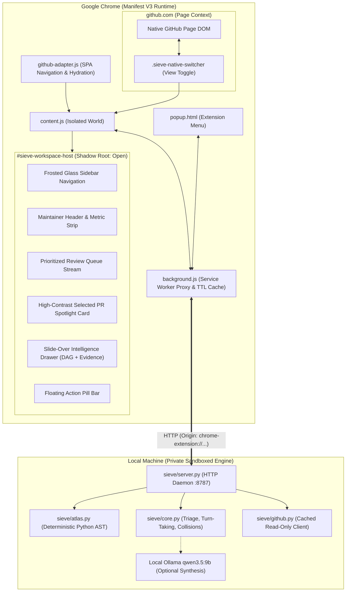

# Sieve Workspace — Technical Architecture Specification

**Product:** Sieve Workspace  
**Status:** Canonical System Architecture  
**Runtime:** Google Chrome Manifest V3 + Localhost Standard-Library Python Daemon

---

## 1. System Topology

---

## 2. Component Breakdown

### 1. Browser Extension Layer (`extension/`)
- **`manifest.json`:** Manifest V3 declaring `storage`, `host_permissions` (`https://github.com/*`, `http://127.0.0.1:8787/*`), background service worker, content scripts, and web-accessible resources.
- **`background.js`:** Service worker proxying all API calls to `http://127.0.0.1:8787`. Enforces 60s in-memory TTL caching, deduplicating identical requests across browser tabs.
- **`github-adapter.js`:** Observes GitHub SPA navigation (`turbo:load`, `turbo:render`, `pjax:end`, `popstate`, `pushState`). Resolves target DOM containers with multi-fallback heuristics.
- **`content.js`:** Mounts `#sieve-workspace-host` with an open Shadow Root, injects `ui/workspace.css`, manages the view toggle (`native` vs `sieve`), and orchestrates UI rendering.
- **`ui/workspace.css`:** Encapsulated stylesheet implementing the complete monochromatic luxury design tokens.
- **`ui/command-center.js`:** The primary workspace UI: frosted sidebar, KPI overview, search/filter controls, review queue, and selected PR spotlight card.
- **`ui/pr-intelligence.js`:** Detailed PR inspection drawer with evidence ledger, SVG DAG visualizer, and 1-click review action composer.
- **`ui/topology-svg.js`:** Deterministic SVG DAG rendering modified files, direct dependents, and tests.
- **`popup/*`:** Extension popup offering engine connectivity telemetry and view preferences.

### 2. Local Engine Layer (`sieve/`)
- **`sieve/server.py`:** Standard library `ThreadingHTTPServer`. Enforces strict Origin checking (`chrome-extension://` and `127.0.0.1` only) and Host header validation. Exposes `/api/health`, `/api/queue`, `/api/analyze`, and `/api/atlas`.
- **`sieve/core.py`:** Queue triage engine computing turn-taking states (`Action Needed: You`, `Waiting on Author`, `Blocked`, `Merge Candidates`, `Bot Stream`), cross-PR duplicate fixes, file collisions, and confidence scores.
- **`sieve/atlas.py`:** Deterministic AST import extraction for Python repositories. Identifies direct dependents and test relationships.
- **`sieve/github.py`:** Read-only GitHub REST client with SHA-keyed on-disk caching.
- **`sieve/llm.py`:** Local Ollama interface (`qwen3.5:9b`) for qualitative maintainer response drafting.

---

## 3. Communication & Data Flow

1. **User navigates to `github.com/:owner/:repo/pulls`:**
   - `github-adapter.js` detects `PULLS` context.
   - `content.js` checks user preference (`activeViewMode`) in `chrome.storage.local`.
   - Injects `.sieve-native-switcher` in the subnav.
   - If Sieve mode is active: hides native list, attaches `#sieve-workspace-host`, links `ui/workspace.css`, and renders skeleton state.
2. **Data Fetching:**
   - Content script sends `GET_QUEUE` to `background.js`.
   - `background.js` checks TTL cache; on miss, fetches `http://127.0.0.1:8787/api/queue?repo=:owner/:repo`.
   - Engine queries GitHub API (or reads cache), computes AST blast radius, checks for cross-PR collisions, and returns structured JSON.
3. **Rendering & User Interaction:**
   - `command-center.js` populates the sidebar, KPI gauges, review queue cards, and spotlight card.
   - Selecting a PR instantly updates the Spotlight Card.
   - Clicking "Inspect Topology" slides open `pr-intelligence.js` with the SVG DAG.
