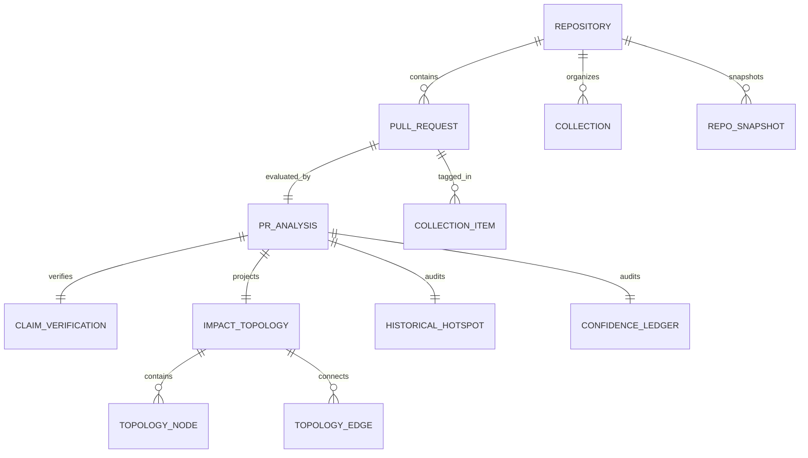

# Sieve Workspace — Data Model & Entities

## 1. Domain Entities & Relationships

---

## 2. Entity Definitions

### 2.1 Repository
- `id`: String (e.g. `"ThatKJ/sieve-demo-target"`)
- `owner`: String
- `repo`: String
- `default_branch`: String
- `open_pr_count`: Integer
- `indexed_sha`: String (Git commit SHA of latest cached snapshot)
- `last_sync`: ISO8601 Timestamp

### 2.2 PullRequest
- `number`: Integer
- `title`: String
- `author`: String
- `author_avatar`: String URL
- `association`: String (`"OWNER"`, `"MEMBER"`, `"FIRST_TIME_CONTRIBUTOR"`, `"NONE"`)
- `state`: String (`"open"`, `"closed"`, `"merged"`)
- `draft`: Boolean
- `created_at`: ISO8601 Timestamp
- `updated_at`: ISO8601 Timestamp
- `changed_files`: Integer
- `additions`: Integer
- `deletions`: Integer
- `linked_issues`: Array of Integers

### 2.3 PRAnalysis
- `score`: Integer (0–100)
- `verdict`: Enum (`"ready"`, `"needs-work"`, `"low-effort"`)
- `category`: Enum (`"needs_attention"`, `"ready_for_review"`, `"potentially_risky"`, `"waiting_for_contributor"`, `"stale"`)
- `findings`: Array of `Finding`
- `impact`: `ImpactTopology`
- `archaeology`: `HistoricalHotspot`
- `ledger`: `ConfidenceLedger`
- `contributor_comment`: String (drafted polite contributor response)
- `reviewer_brief`: String (hand-off summary for maintainer)

### 2.4 ImpactTopology
- `nodes`: Array of `TopologyNode`
  - `id`: File path string
  - `role`: Enum (`"modified"`, `"added"`, `"removed"`, `"renamed"`, `"direct"`, `"indirect"`, `"dependency"`, `"test-inferred"`)
  - `lang`: String (`"python"`, `"javascript"`, `"typescript"`)
  - `is_test`: Boolean
  - `degree`: Integer (number of connections)
  - `symbols`: Array of Strings (top-level classes, functions)
  - `reason`: String (evidence explaining inclusion)
- `edges`: Array of `TopologyEdge`
  - `source`: String (importer path)
  - `target`: String (imported path)
  - `line`: Integer (line number of import statement)
  - `stmt`: String (exact import code text)
  - `names`: Array of Strings (symbols imported)
- `summary`:
  - `changed_files`: Integer
  - `direct_dependents`: Integer
  - `related_test_files`: Integer
  - `unresolved_imports`: Integer
- `limitations`: Array of Strings (e.g. `"Dynamic imports not tracked"`)

### 2.5 HistoricalHotspot (Archaeology)
- `time_window_days`: Integer (default 90)
- `files_inspected`: Array of Strings
- `total_commits`: Integer
- `distinct_contributors`: Integer
- `per_file_churn`: Map (`file_path -> commit_count`)
- `candidate_reverts`: Array of Commit objects (`sha`, `message`, `author`, `date`, `url`, `file`)
- `candidate_fixes`: Array of Commit objects (`sha`, `message`, `author`, `date`, `url`, `file`)
- `status`: Enum (`"ok"`, `"no_history"`, `"empty_diff"`)

### 2.6 Collection (Maintainer Folders)
- `id`: String (UUID)
- `repo`: String (`"owner/repo"`)
- `name`: String (e.g. `"Release 2.0"`, `"Security Audit"`)
- `color`: String (hex code or preset identifier)
- `pr_numbers`: Array of Integers
- `created_at`: ISO8601 Timestamp

---

## 3. Provenance & Confidence Ledger Schema

Every finding is attributed to one of four verifiable source tiers:
1. `DETERMINISTIC_AST`: Derived from Python AST parsing of the repository tree.
2. `GIT_TREE`: Direct GitHub Tree / Blob REST metadata.
3. `GIT_LOG`: Commit log history heuristics (churn, commit message keywords).
4. `LOCAL_LLM`: Open-weight semantic judgment, explicitly labeled as model opinion.
5. `UNKNOWN / UNVERIFIED`: Explicitly stated negative space (runtime test execution, dynamic imports).

