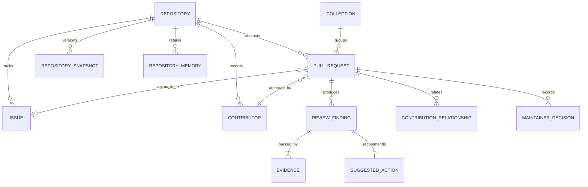

# Sieve Workspace V2 — Domain Entities & Data Model Specification

**Date:** October 31, 2026  
**Auditor:** Principal Software Architect & Staff Database Engineer  
**Status:** Approved Schema Specification (Supersedes V1)

---

## 1. Domain Entities & Entity-Relationship Model

---

## 2. Detailed Entity Specifications

### 1. `Repository`
- **Fields:** `id` (int), `owner` (text), `name` (text), `default_branch` (text), `primary_language` (text), `is_fork` (bool), `last_indexed_at` (timestamp).
- **Storage Tier:** SQLite Local Cache (`~/.sieve/workspace.db`).
- **Refresh Policy:** Refreshed on repository navigation if older than 1 hour.

### 2. `PullRequest`
- **Fields:**
  - `id` (text: `owner/repo#number`)
  - `number` (int)
  - `title` (text)
  - `author_id` (text: foreign key to Contributor)
  - `base_sha` (text), `head_sha` (text)
  - `state` (enum: `open`, `closed`, `merged`)
  - `turn_status` (enum: `action_needed_you`, `waiting_on_contributor`, `blocked`, `merge_candidate`, `bot_stream`)
  - `ci_status` (enum: `success`, `failure`, `pending`, `neutral`)
  - `mergeable_state` (enum: `clean`, `conflicting`, `blocked`, `unknown`)
  - `lines_added` (int), `lines_deleted` (int), `changed_files_count` (int)
  - `sieve_verdict` (enum: `ready`, `needs_work`, `low_effort_slop`, `blocked`)
  - `blast_radius_score` (int)
  - `created_at` (timestamp), `updated_at` (timestamp)
- **Storage Tier:** Hybrid (Fetched via GitHub REST, enriched and cached in SQLite).
- **Refresh Policy:** Cached by `head_sha`. If `head_sha` matches cache, serves in 2ms. If `head_sha` changes (new commit pushed), invalidates and re-computes AST topology.

### 3. `ContributionRelationship` (The Multi-PR Moat)
Tracks semantic relationships between multiple pull requests:
- **Fields:**
  - `id` (uuid)
  - `source_pr_id` (text), `target_pr_id` (text)
  - `relationship_type` (enum: `duplicate_intent`, `file_collision`, `dependent_stack`, `competing_fix`)
  - `shared_entity` (text: e.g. `issue:#42` or `file:sieve/calc.py`)
  - `severity` (enum: `critical_collision`, `warning`, `info`)
  - `detected_at` (timestamp)
- **Storage Tier:** Computed in-memory on queue scan, persisted in SQLite for cross-session triage.

### 4. `ReviewFinding` & `Evidence`
- **`ReviewFinding` Fields:**
  - `id` (uuid)
  - `pr_id` (text)
  - `category` (enum: `issue_grounding`, `test_coverage`, `architectural_blast_radius`, `convention_adherence`, `churn_hotspot`)
  - `severity` (enum: `blocker`, `warning`, `info`, `pass`)
  - `title` (text)
  - `message` (text)
- **`Evidence` Fields:**
  - `finding_id` (uuid)
  - `evidence_type` (enum: `ast_import`, `git_diff_hunk`, `test_assertion`, `commit_history`, `convention_file`)
  - `source_path` (text)
  - `line_number` (int, optional)
  - `raw_content` (text)
  - `provenance` (enum: `deterministic_ast`, `github_api`, `llm_synthesis`)

### 5. `MaintainerDecision` & `RepositoryMemory`
- **`MaintainerDecision` Fields:**
  - `id` (uuid)
  - `pr_id` (text)
  - `decision_type` (enum: `approved`, `changes_requested`, `closed_duplicate`, `closed_spam`, `deferred`)
  - `reason` (text)
  - `timestamp` (timestamp)
- **`RepositoryMemory` Fields:**
  - `repo_id` (int)
  - `key` (text: e.g. `convention:preferred_test_runner`, `policy:require_issue_link`)
  - `value` (json)
  - `updated_at` (timestamp)
- **Purpose:** Enables Sieve to learn repository-specific rules over time (e.g. "Maintainer always requests pytest fixtures instead of unittest in `tests/`").

---

## 3. Data Freshness, Invalidation, and Offline Resilience

| Entity | Primary Data Source | Invalidation Trigger | Staleness Threshold |
| :--- | :--- | :--- | :--- |
| **Pull Request Meta** | GitHub REST API | Turbo page navigation / explicit refresh | 5 minutes |
| **PR Blast Radius & AST** | Computed locally | Change in PR `head_sha` | Immutable per SHA |
| **CI / Check Runs** | GitHub Statuses API | Turbo navigation or user hover | 60 seconds |
| **Historical Hotspots** | GitHub Commits API | Commit to base branch (`main`) | 24 hours |
| **Maintainer Collections** | `chrome.storage.local` | Maintainer user edit | Persistent |
| **Repository Memory** | Local SQLite | Maintainer decision events | Persistent |

---

## 4. Multi-Maintainer & Team Synchronization

In open-source projects managed by a distributed team (e.g. 5 co-maintainers):
1. **Local-Only Baseline (Default):** Individual maintainers run Sieve locally. Their collections and inbox states live in their local browser and SQLite instance. Zero shared infrastructure required.
2. **Repository-Backed Sync (V2.2 Target):** Maintainer collections, triage labels, and repository memory can be synced via a lightweight git-backed file (e.g. `.github/sieve-memory.json` or private GitHub repository discussions), ensuring zero third-party cloud data hosting.

