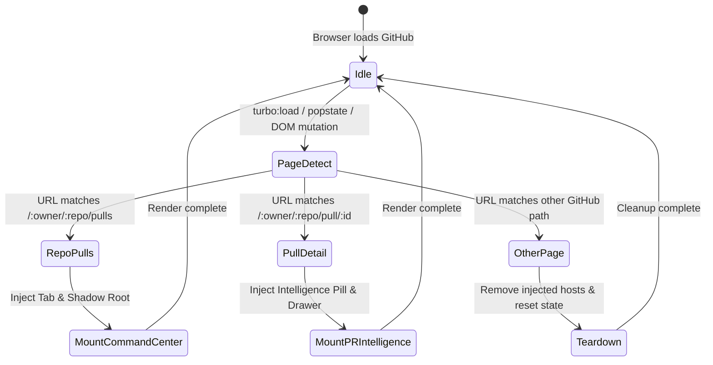

# Sieve Workspace — Browser Extension Architecture

## 1. Manifest V3 Strategy

The Sieve Workspace extension is built strictly in compliance with Chrome's Manifest V3 standard, with designed portability for Firefox (MV3 with background scripts or event pages).

### Permissions Required:
- `storage`: For storing maintainer custom collections, pinned filters, engine connection settings, and view preferences.
- `alarms`: For periodic cache cleanup and background health checks.
- `host_permissions`:
  - `https://github.com/*`: To detect and mount the workspace across repositories.
  - `https://api.github.com/*`: For client-side authenticated queries when operating without a local backend.
  - `http://127.0.0.1:8787/*` & `http://localhost:8787/*`: For communicating with the Sieve Intelligence Engine.

---

## 2. GitHub SPA Navigation & Page Lifecycle

GitHub is a single-page application built on GitHub Turbo / PJAX. Page changes occur without full browser window reloads.



### 2.1 SPA Lifecycle Event Handling
The extension attaches to multiple lifecycle hooks to guarantee zero missed transitions:
1. `document.addEventListener("turbo:load", handlePageChange)` (Modern GitHub Turbo)
2. `document.addEventListener("turbo:render", handlePageChange)`
3. `document.addEventListener("pjax:end", handlePageChange)` (Legacy PJAX fallback)
4. Hooking `history.pushState` and `history.replaceState` via custom event dispatch.
5. Window `popstate` listener for browser back/forward buttons.
6. MutationObserver on the GitHub main container (`#js-repo-pjax-container`, `main`) with debounce protection.

### 2.2 Idempotency & Clean Teardown
- Before mounting any component, the adapter checks for existing hosts (`#sieve-workspace-host`).
- If navigating away from `/pulls`, the adapter cleanly unmounts the workspace and restores GitHub's native container visibility (`style.display = ""`), leaving zero residual DOM mutations.

---

## 3. UI Isolation via Shadow DOM

GitHub's Primer CSS uses aggressive global selectors (e.g. `*`, `a`, `.btn`, `table`, `input`) that conflict with external applications.

### Solution: Shadow DOM Encapsulation
- The extension creates an element:
  ```html
  <div id="sieve-workspace-host">
    #shadow-root (open)
      <link rel="stylesheet" href="chrome-extension://.../ui/workspace.css">
      <div class="sieve-workspace-container">...</div>
  </div>
  ```
- **Benefits:**
  1. Complete CSS style isolation: Sieve styles cannot leak into GitHub, and GitHub's Primer CSS cannot break Sieve.
  2. Isolated event bubbling: Internal Sieve clicks and keyboard navigations don't accidentally trigger GitHub shortcut hotkeys.
  3. Clean teardown: Removing `#sieve-workspace-host` completely removes the entire Sieve DOM sub-tree in a single atomic call.

---

## 4. Page Adapters Architecture

The extension uses modular page adapters located in `extension/adapters/`:

1. **`RepoPullsAdapter` (`github.com/:owner/:repo/pulls`):**
   - Targets the subnav header (where filters like `Open`, `Closed`, and search are located).
   - Injects a styled tab toggle: `[Native GitHub (N)] [Sieve Workspace (N)]`.
   - On selecting "Sieve Workspace", hides GitHub's `.js-check-all-container` and renders the **Maintainer Command Center**.
2. **`PullDetailAdapter` (`github.com/:owner/:repo/pull/:id`):**
   - Injects a Sieve Verdict Pill (e.g. `95/100 Ready` or `Needs Work`) into the PR title header next to GitHub's native `Open` badge.
   - Injects a floating action button / expandable intelligence drawer containing the **PR Blast Radius Topology**, **Claim Verification Ledger**, and **Hotspot Forensics**.
3. **`NavigationAdapter`:**
   - Detects owner and repo names from `location.pathname.split("/")`.
   - Normalizes URLs and handles repository renaming/redirects.

---

## 5. Client-Side Storage Architecture (`chrome.storage.local`)

Sieve persists maintainer preferences without needing a heavy cloud database:
```typescript
interface SieveExtensionStorage {
  engineUrl: string; // Default: "http://127.0.0.1:8787"
  githubToken?: string; // Optional user PAT
  activeView: "native" | "sieve"; // Default view preference
  savedCollections: {
    [repoKey: string]: {
      id: string;
      name: string;
      prNumbers: number[];
      color?: string;
      createdAt: string;
    }[];
  };
  cachedAnalyses: {
    [prKey: string]: {
      timestamp: number;
      data: any;
    };
  };
}
```
All storage operations are asynchronously debounced and namespaced per repository (`${owner}/${repo}`).

