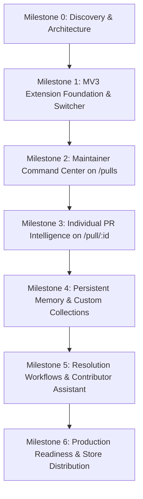

# Sieve Workspace — Implementation Roadmap

## Overview

This roadmap defines the engineering progression from Sieve's standalone engine into the fully featured **Sieve Workspace** browser platform.

---

## Milestone Breakdown

### Milestone 0: Discovery & Architecture (Completed)
- **Deliverables:** Architecture assessment, competitor deep-dive, 10 specification documents in `docs/workspace/`.
- **Status:** Complete.

### Milestone 1: Extension Foundation & Native Switcher (Current Target)
- **Goal:** Install the extension, open any GitHub repository, and seamlessly switch between Native GitHub and Sieve Workspace without breaking GitHub.
- **Components:**
  - Manifest V3 manifest (`manifest.json`) with permissions.
  - Background Service Worker (`background.js`) handling API proxy and health checks.
  - Page Adapter (`github-adapter.js`) handling GitHub Turbo/PJAX navigation.
  - Shadow DOM mounting container with isolated Liquid Glass styling.
  - View switcher tab injected alongside native GitHub PR navigation.
  - Extension popup with backend health and connection diagnostics.
- **Acceptance Criteria:**
  - Extension loads in `chrome://extensions` with zero warnings.
  - Injects clean tab switcher on `github.com/:owner/:repo/pulls`.
  - Toggling views hides/shows native GitHub content non-destructively.
  - Survives client-side SPA page transitions.

### Milestone 2: Maintainer Command Center
- **Goal:** Transform `/pulls` into an organized maintainer triage inbox.
- **Components:**
  - Repository header with real metadata.
  - Triage metric chips (Needs Attention, Ready, Risky, Stale).
  - Structured PR cards displaying Sieve score, author, blast radius summary, and status.
  - Fast search, category filtering, and sorting controls.
- **Acceptance Criteria:**
  - Renders live PR data from `/api/queue`.
  - Accurately classifies PRs based on deterministic checks.
  - Clicking a PR card opens native PR or embedded view.

### Milestone 3: Individual PR Intelligence
- **Goal:** Provide embedded change intelligence directly on `github.com/:owner/:repo/pull/:id`.
- **Components:**
  - PR Header Verdict Pill.
  - Embedded drawer with SVG Impact Topology DAG.
  - Historical Hotspot Radar with churn bars and candidate reverts.
  - Confidence Ledger with proof provenance.
  - Suggested Contributor Response copy drawer.
- **Acceptance Criteria:**
  - Loads immediately upon navigating to a PR.
  - Zero disruption to native GitHub comments and review actions.

### Milestone 4: Persistent Memory & Custom Collections
- **Goal:** Multi-session organization and historical repository knowledge.
- **Components:**
  - Custom user collections (e.g. "Release 2.0") stored in `chrome.storage.local`.
  - Cross-PR duplicate detection.
  - Historical decision tracking.

### Milestone 5: Resolution Workflows
- **Goal:** Accelerate routine maintainer responses.
- **Components:**
  - One-click copy for politely phrased contributor fix-it checklists.
  - Review summary generator for co-maintainers.
  - Human-in-the-loop permission model (zero automated posting).

### Milestone 6: Production Readiness & Distribution
- **Goal:** Enterprise security, multi-repo scalability, and Chrome Web Store publishing.
- **Components:**
  - Automated CI packaging and linting (`web-ext`).
  - Optional hosted backend deployment for distributed teams.
  - Rate-limit mitigation with GitHub App installations.

