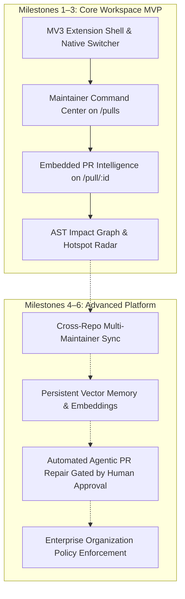

# Sieve Workspace — Product Vision

## 1. Executive Summary

**Product Name:** Sieve Workspace  
**Tagline & Positioning:** *GitHub, redesigned for maintainers.*  
**Form Factor:** Chrome Manifest V3 Browser Extension backed by a local/private Sieve Intelligence Engine.

GitHub is optimized for authors submitting code, not maintainers triaging dozens of incoming contributions. Maintainers are inundated with outside pull requests—ranging from high-quality fixes to AI-generated slop, superficial README edits, and hallucinated imports.

**Sieve Workspace** operates directly inside GitHub. It preserves GitHub as the single source of truth while embedding a dedicated maintainer intelligence layer directly into the repository interface (`/pulls` and `/pull/:id`). Maintainers never need to switch to an external dashboard or context-switch away from their daily workflow.

---

## 2. Core Value Proposition

> *"Know which pull requests deserve your time — without leaving GitHub."*

When a maintainer opens their repository, Sieve Workspace immediately answers eight critical operational questions:
1. **What needs my attention?** Clear operational signal separated from automated bot noise.
2. **Which PRs should I review first?** Deterministic ranking based on claim verification and blast radius.
3. **What did the contributor actually change?** Grounded diff inspection versus what the PR description claims.
4. **What could these changes break?** Deterministic AST import topology and dependent blast radius.
5. **Are there duplicate efforts or competing PRs?** Cross-PR and issue correlation.
6. **What decisions were made previously?** Historical commit forensics, churn radar, and revert tracking.
7. **What should happen next?** Actionable verification plan (steps to test, inspect, or request).
8. **Can Sieve help me resolve it?** Maintainer-approved contributor replies, review checklists, and task handoffs.

---

## 3. Product Principles

1. **Maintainer-First, Not Contributor-First:** Designed specifically to reduce maintainer cognitive load, decision fatigue, and triage time.
2. **Evidence Before AI Opinions:** Deterministic AST analysis, tree checks, and git logs are prioritized over model guesses. AI (local open-weight models) is reserved strictly for bounded semantic judgments.
3. **Context Before Recommendations:** Impact graphs and historical churn provide structural context before suggesting reviews.
4. **Non-Invasive GitHub Integration:** Sieve augments GitHub seamlessly via a non-destructive view toggle (`GitHub Native` vs `Sieve Workspace`). Native GitHub features remain 100% accessible.
5. **Zero Automatic GitHub Actions:** Sieve is strictly read-only by default. It never posts automated comments, assigns labels, or closes PRs without explicit maintainer review and approval.
6. **Privacy & Zero Marginal Inference Cost:** Runs inference locally or on private maintainer infrastructure (via Ollama / local weights), ensuring repository code never leaks to third-party model training.

---

## 4. Target Personas

### Primary Persona: Open-Source Maintainer (Community-Backed)
- **Pain:** 20–100 PRs/month, high ratio of drive-by AI contributions, repetitive requests for tests, lack of time.
- **Goal:** Filter out noise in under 10 seconds per PR; quickly identify high-leverage community contributions.

### Secondary Persona: Commercial Open-Source Lead (Company-Backed OSS)
- **Pain:** Paid engineering time wasted reviewing non-compliant or broken community PRs on projects like Supabase, Cal.com, or PostHog.
- **Goal:** Defend repository architecture, prevent regressions in shared modules, and maintain high contribution velocity.

---

## 5. Scope & MVP Boundaries

### In Scope for MVP
- Manifest V3 Chrome Extension.
- Non-destructive view toggle on GitHub repository PR tabs (`/pulls`).
- Structured Maintainer Inbox with smart classifications (Needs My Attention, Ready for Review, Potentially Risky, Waiting for Contributor, Stale).
- Embedded PR intelligence drawer on individual PR pages (`/pull/:id`).
- Real-time communication with local Sieve server (`http://127.0.0.1:8787`).
- Local persistent collections and filters stored via Chrome Extension Storage API.
- Fully isolated styles using Shadow DOM.

### Out of Scope for MVP
- Automatic GitHub commenting or merging.
- Multi-tenant cloud hosting infrastructure (addressed in Milestone 6).
- Third-party IDE plugins (JetBrains/VS Code).

