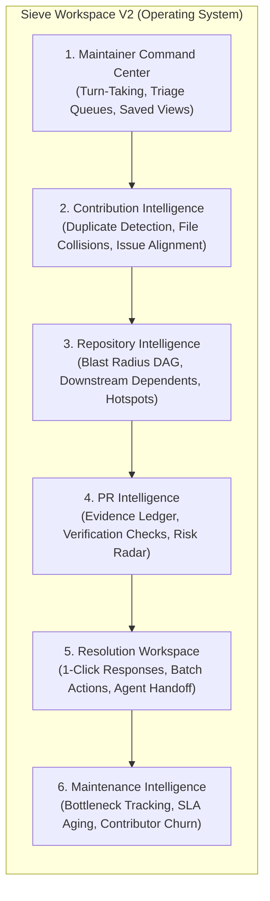

# Sieve Workspace V2 — Product Vision & Capability Blueprint

**Date:** October 31, 2026  
**Product:** Sieve Workspace  
**Tagline:** *GitHub, redesigned for maintainers.*  
**Core Promise:** *Know which contributions deserve your time — without leaving GitHub.*

---

## 1. Product Reframing: Beyond PR Review into Contribution Management

A developer tool that simply adds AI comments to a PR is not a product—it is a commodity prompt.

A maintainer's primary bottleneck is **not** reading code diffs. A senior maintainer can read a 50-line diff in 30 seconds.

A maintainer's true bottlenecks are:
1. **Triaging the incoming firehose:** Figuring out which of the 40 open PRs actually need action today.
2. **Filtering out low-effort noise & AI slop:** Quickly identifying contributions generated blindly with LLMs that claim to fix an issue but introduce subtle bugs or trivial assertions.
3. **Tracking turn-taking ("Who has the ball?"):** Knowing whether a PR is waiting on the maintainer to review or on the contributor to address changes.
4. **Detecting collisions and duplicates:** Catching when 4 contributors submit overlapping fixes for the same issue before wasting time reviewing all four.
5. **Safeguarding repository architecture:** Verifying that a PR's claimed changes match its actual blast radius across downstream dependents and tests.

**Sieve Workspace V2** is not another AI PR reviewer. It is an **in-situ contribution management operating system** that runs directly inside GitHub via a private browser extension.

---

## 2. Six Core Capability Domains

---

### A. Maintainer Command Center (The Primary Cockpit)
- **Turn-Taking Inbox:**
  - `Action Needed: You`: PRs where you are requested for review, or where the author has pushed new commits addressing previous review comments.
  - `Waiting on Contributor`: PRs where changes have been requested and the author has not pushed new commits.
  - `Review Blocked`: PRs blocked by failing CI, merge conflicts, or missing base branches.
  - `Merge Candidates`: Approved PRs with green CI ready for a final merge click.
- **Dedicated Bot Stream:** Isolates Renovate, Dependabot, and automated tool PRs out of the human review queue.
- **Fast Keyboard Navigation:** `j`/`k` to navigate PR cards, `x` to select, `e` to mark reviewed, `r` to open the intelligence drawer, `Enter` to jump to native PR.
- **Saved Views & Custom Collections:** Maintainers can bundle PRs by milestone, component, or community campaign.

### B. Contribution Intelligence (Cross-PR Awareness)
- **Duplicate PR Detection:** Groups PRs that reference the same open issue or touch identical AST symbols.
- **Overlapping Code Change Warnings:** Flags when two concurrent PRs modify the same files, preventing future merge conflicts.
- **Claim vs. Reality Alignment:** Verifies whether the PR title and description correspond to the actual git patch (e.g., flags when a PR claims to "fix authentication bug" but only updates documentation or modifies unrelated files).
- **Contributor Provenance:** Badges first-time contributors vs. trusted repeat maintainers to calibrate review depth.

### C. Repository Intelligence (Deterministic Architectural Gates)
- **Blast Radius Topology DAG:** Real-time visual DAG showing modified files, internal direct dependents, and relevant test files.
- **Polyglot Import Resolution:** Static AST parsing supporting Python, TypeScript/JavaScript, and Go without running untrusted code.
- **Historical Hotspot Radar:** Highlights files with high commit churn, frequent regression fixes, or recent reverts in the last 90 days.
- **Test Relationship Mapping:** Confirms whether modified modules have corresponding unit tests updated in the diff.

### D. PR Intelligence (The Deep Inspection Lens)
- **The Confidence Ledger:** Breaks down the verdict into evidence-backed line items:
  - `Issue Grounding:` Linked issue #42 verified open and relevant.
  - `Test Coverage:` Claims to add tests -> 2 test files modified with 8 new test assertions.
  - `Convention Safety:` Follows PR template, semantic commit format, and CONTRIBUTING.md rules.
  - `Architectural Impact:` 1 modified file, 3 downstream dependents, 0 cyclic imports.
- **Risk Signals:** Clear badges for `Missing Tests`, `Merge Conflict`, `High Churn Hotspot`, `Unlinked Issue`.

### E. Resolution Workspace (High-Leverage Maintainer Actions)
- **1-Click Review Templates:** Instant maintainer feedback tailored to the specific finding (e.g., "Thanks for the contribution! Could you please add a unit test covering the negative balance case in `test_calc.py`?").
- **Batch Triage:** Select multiple PRs to batch-label, batch-request changes, or batch-close low-effort AI spam.
- **Coding Agent Handoff:** Export a PR's findings, diff, and blast radius into an agent prompt for local coding assistants (Gemini, Claude Code, Aider).

### F. Project Maintenance Intelligence (Long-Term Health)
- **Turnaround Velocity:** Tracks average time-to-first-review and time-to-merge.
- **Stale Contribution Sweeper:** Automatically surfaces PRs abandoned by authors for 30+ days.
- **Review Workload Balance:** Visualizes maintainer review distribution across core team members.

---

## 3. Capability Prioritization & Feasibility Matrix

| Capability Domain | Maintainer Value | Differentiation | Technical Complexity | Data Requirements | Trust Requirements | Delivery Phase | Validation Needed |
| :--- | :---: | :---: | :---: | :---: | :---: | :---: | :--- |
| **Turn-Taking Inbox (`You` vs `Contributor`)** | **Critical (10/10)** | **High (9/10)** | Medium (5/10) | GitHub PR reviews & timeline events | Low (Read-only) | **Phase 1 (V2.0)** | Maintainer review time reduction |
| **Duplicate / Collision Detection** | **Critical (10/10)** | **Very High (10/10)** | Medium (6/10) | Multi-PR file diffs & issue links | Low (Read-only) | **Phase 1 (V2.0)** | Accurate grouping on multi-PR repos |
| **Bot PR Stream Isolation** | **High (8/10)** | **Medium (6/10)** | Low (2/10) | Author login metadata | Zero | **Phase 1 (V2.0)** | Inbox clutter reduction |
| **Interactive 1-Click Response Templates** | **High (8/10)** | **High (8/10)** | Low (3/10) | Sieve confidence ledger | Low (Human in loop) | **Phase 1 (V2.0)** | Fast response drafting |
| **Polyglot AST (TS/JS + Python)** | **High (9/10)** | **High (8/10)** | High (8/10) | Static tree-sitter or parser | Low | **Phase 2 (V2.1)** | Accurate dependent resolution in TS repos |
| **Historical Hotspot Cache (SQLite)** | **Medium (7/10)** | **Medium (6/10)** | Medium (5/10) | GitHub commit history API | Low | **Phase 2 (V2.1)** | Zero 403 rate-limit errors |
| **Batch Review & Triage Actions** | **High (9/10)** | **High (8/10)** | Medium (6/10) | GitHub write API (Token required) | Medium (User action) | **Phase 2 (V2.1)** | Batch triage speedup |
| **Agent Task Handoff** | **Medium (6/10)** | **High (8/10)** | Medium (5/10) | Local prompt formatting | Low | **Phase 3 (V2.2)** | Maintainer handoff utility |
| **Maintenance Bottleneck Analytics** | **Medium (6/10)** | **Low (4/10)** | High (7/10) | Long-term event history | Low | **Phase 3 (V2.2)** | Operator retention |

---

## 4. Phased Product Delivery

### Release V2.0 — The Usable Daily Triage Cockpit (Immediate Focus)
1. **Turn-Taking Triage:** `Action Needed: You`, `Waiting on Contributor`, `Blocked`, `Merge Candidates`.
2. **Bot PR Stream:** Separate tab isolating Renovate/Dependabot PRs.
3. **Cross-PR Duplicate & Collision Detector:** Flags PRs modifying identical files or targeting identical issues.
4. **Origin-Secured Local Engine:** Local SQLite cache preventing GitHub API 403 rate limits.
5. **Keyboard Shortcuts:** Fast `j`/`k`/`Enter`/`r` triage navigation.

### Release V2.1 — Multi-Language & Interactive Actions
1. **TypeScript/JavaScript AST Import Topology:** Tree-sitter or WASM parser for web repositories.
2. **Interactive In-Situ Actions:** One-click review submission, label assignment, and friendly rejection.
3. **Historical Churn Radar (SQLite-backed):** Persistent git history tracking without rate limits.

### Release V2.2 — Team Sync & Agent Handoff
1. **Multi-Maintainer Shared Notes:** Encrypted local or repository-based shared review flags.
2. **Agent Fix Handoff:** Export verified findings directly to local coding CLI agents.

