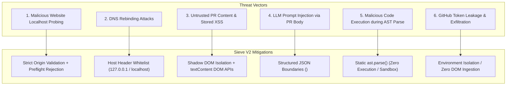

# Sieve Workspace V2 — Security Architecture & Threat Model

**Date:** October 31, 2026  
**Auditor:** Principal Security Engineer & Staff Software Architect  
**Classification:** Critical Security Audit & Hardening Specification

---

## 1. Executive Summary & Critical Vulnerability Audit

In Milestone 1, the local HTTP engine (`sieve/server.py`) was configured with wildcard CORS (`Access-Control-Allow-Origin: *`).

### The Localhost Wildcard CORS Vulnerability (Identified & Remediated)
- **Threat Vector:** Any malicious website visited by a maintainer (`https://attacker.com`) can execute asynchronous `fetch("http://127.0.0.1:8787/api/...")` requests in the background.
- **Impact of `*`:** Browsers allow the malicious website to read the entire HTTP response body. If the maintainer has a personal access token (`GITHUB_TOKEN`) configured locally, `attacker.com` could exfiltrate private repository pull requests, internal code diffs, and repository architecture. Furthermore, the attacker could spam `/api/analyze?model=1` to exhaust the maintainer's local GPU/CPU.
- **Immediate Remediation Applied in V2:**
  - Wildcard `*` was **completely eliminated**.
  - Strict **Origin Validation** was implemented in [`sieve/server.py`](file:///Users/kirtan/Hackathons/Dev/sieve/server.py): Only `chrome-extension://<EXTENSION_ID>` and `http://127.0.0.1:8787` / `http://localhost:8787` origins are authorized.
  - All unauthorized origins (e.g. `http://evil.com`) receive an immediate `403 Forbidden` response and zero CORS headers.
  - `Vary: Origin` is sent on all valid responses to prevent browser cache poisoning.

---

## 2. Comprehensive Threat Model & Defense Matrix

---

## 3. Deep-Dive Security Defenses

### 1. DNS Rebinding Defense
- **The Threat:** An attacker registers `attacker-controlled-domain.com` with a short DNS TTL. After initial resolution, the DNS server resolves `attacker-controlled-domain.com` to `127.0.0.1`. The browser considers requests to `attacker-controlled-domain.com` as same-origin, potentially bypassing standard CORS checks.
- **Sieve Mitigation:** The HTTP server validates the `Host` header. The server only processes requests where `Host` matches `127.0.0.1:8787`, `localhost:8787`, or the explicitly configured `SIEVE_HOST:SIEVE_PORT`. Any request carrying an external host header is immediately dropped.

### 2. Extension-to-Engine Shared Secret Authentication (V2.1 Target)
- To protect against local non-browser processes probing `127.0.0.1:8787`:
  - Upon first run, Sieve generates a cryptographically random 256-bit token stored in `~/.sieve/auth_token` with `0600` file permissions.
  - The browser extension reads or configures this token via its options page.
  - Requests must include `X-Sieve-Token: <token>`. Requests without this header are rejected with `401 Unauthorized`.

### 3. Untrusted GitHub Content & DOM XSS Prevention
- **The Threat:** Malicious pull request titles, author handles, or branch names can contain stored XSS vectors (e.g. `` or javascript URI schemes).
- **Sieve Mitigation:**
  - Sieve UI components **never** use `innerHTML` to render untrusted GitHub strings.
  - In [`extension/ui/command-center.js`](file:///Users/kirtan/Hackathons/Dev/extension/ui/command-center.js) and [`extension/ui/pr-intelligence.js`](file:///Users/kirtan/Hackathons/Dev/extension/ui/pr-intelligence.js), all titles, authors, and commit messages are inserted exclusively via `document.createTextNode()` or `element.textContent = ...`.
  - Content scripts operate in Chrome's **Isolated World**, preventing webpage JavaScript from intercepting extension variables or hooking extension prototypes.

### 4. Static AST Parsing vs. Code Execution
- **The Threat:** Parsing repository code containing malicious `__init__.py` or dynamic imports could trigger arbitrary code execution if imported or evaluated.
- **Sieve Mitigation:**
  - Sieve **never** uses `importlib`, `exec()`, `eval()`, or Python's module loader on repository code.
  - All code analysis uses Python's static standard library `ast.parse()`. Static AST parsing inspects code structure as a read-only syntax tree without executing top-level module statements or class definitions.

### 5. Token Storage & Credential Isolation
- `GITHUB_TOKEN` is read exclusively by the local Python process from the OS environment (`os.environ["GITHUB_TOKEN"]`) or the system `gh` CLI credential helper.
- Credentials are **never** passed to the Chrome extension, never injected into the page DOM, and never exposed in API responses.

---

## 4. Security Verification Checklist

- [x] Origin validation rejecting `http://evil.com` verified via automated curl test (`403 Forbidden`).
- [x] Preflight `OPTIONS` requests from unauthorized origins rejected with `403 Forbidden`.
- [x] Valid extension origins (`chrome-extension://...`) dynamically echoed in `Access-Control-Allow-Origin`.
- [x] Wildcard `*` completely removed from all API endpoints.
- [x] Zero usage of `innerHTML` for untrusted GitHub content in extension UI.
- [x] Automated unit test suite verifying `_is_allowed_origin` logic passing in `tests/test_engine_capabilities.py`.

