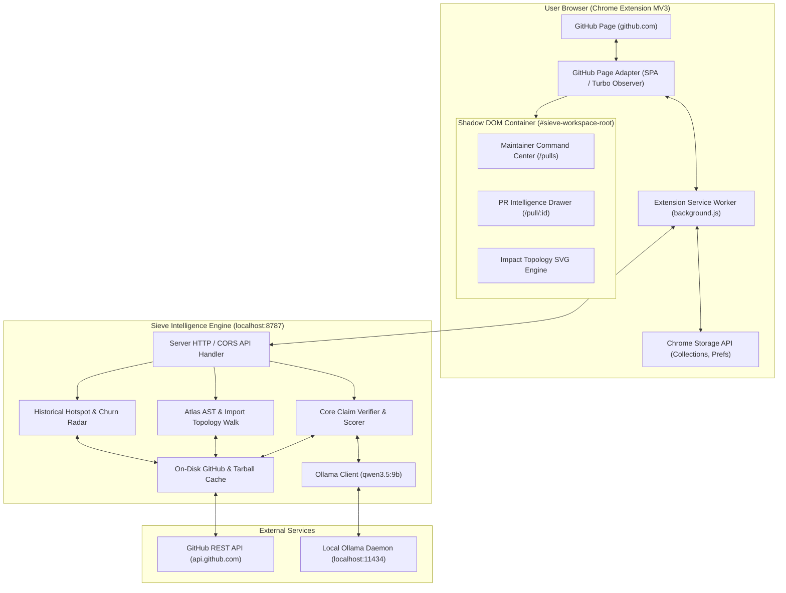

# Sieve Workspace — System Architecture

## 1. System Overview

Sieve Workspace is composed of two primary systems:
1. **Sieve Browser Extension (Client Layer):** A Manifest V3 Chrome extension running on `github.com`. It detects active repository context, injects non-destructive view switchers, manages local state/collections, and renders the Maintainer Command Center and PR Intelligence drawers within an isolated Shadow DOM.
2. **Sieve Intelligence Engine (Backend Layer):** A Python service (running locally on `127.0.0.1:8787` or hosted for organizations). It connects to the GitHub REST API (with caching), builds in-memory AST import graphs, performs claim verification, analyzes commit churn/hotspots, and queries the local open-weight model (`qwen3.5:9b`).

---

## 2. Component Responsibilities

| Component | Responsibility | Environment |
| :--- | :--- | :--- |
| **`github-adapter.js`** | Detects repository coordinates (`owner`, `repo`, `view`, `prNumber`), observes GitHub Turbo/PJAX navigation, and mounts/unmounts Sieve UI elements without mutating GitHub's native DOM trees. | Content Script |
| **`shadow-root`** | Enforces complete CSS and DOM isolation between GitHub's Primer CSS and Sieve's Liquid Glass design system. | Injected DOM |
| **`background.js`** | Acts as the privileged MV3 service worker. Handles cross-origin requests to the local Sieve engine, manages token credentials, handles extension badge updates, and coordinates storage. | Service Worker |
| **`sieve/server.py`** | Stdlib Python HTTP server providing CORS-enabled REST endpoints (`/api/health`, `/api/analyze`, `/api/atlas`, `/api/queue`). | Local Engine |
| **`sieve/core.py`** | Deterministic claim verification, rule checks, penalty scoring, confidence ledger computation, and contributor reply drafting. | Local Engine |
| **`sieve/atlas.py`** | In-memory tarball extraction, AST import extraction, reverse dependency traversal, and blast radius calculation. | Local Engine |
| **`sieve/github.py`** | Authenticated read-only GitHub client with on-disk caching (`.cache/github/`) and tarball SHA caching. | Local Engine |

---

## 3. Communication Protocols & Message Flow

### 3.1 Page Lifecycle & Mounting
1. User navigates to `https://github.com/owner/repo/pulls`.
2. `github-adapter.js` detects URL match and fires `onRepoPullsPage(owner, repo)`.
3. Injects a non-destructive tab toggle (`[Native GitHub] [Sieve Workspace]`) inside GitHub's subnavigation bar.
4. If "Sieve Workspace" is activated:
   - Sets GitHub's native `.js-check-all-container` or PR list container to `display: none` (never deleted).
   - Injects `
` with an open `ShadowRoot`.
   - Mounts the Maintainer Command Center inside the shadow root.
   - Queries `GET /api/queue?repo=owner/repo` via the background service worker or direct fetch.

### 3.2 Individual PR Intelligence
1. User navigates to `https://github.com/owner/repo/pull/123`.
2. `github-adapter.js` detects individual PR view.
3. Injects a floating or docked **Sieve Intelligence Badge / Drawer** directly into GitHub's PR header and sidebar.
4. Queries `GET /api/analyze?pr=owner/repo#123` and loads the AST Impact Topology and Hotspot Radar directly within GitHub.

---

## 4. Trust Boundaries & Security Architecture

1. **DOM Boundary:** Sieve UI runs inside a `ShadowRoot` with isolated stylesheet scoping. External GitHub scripts cannot easily corrupt Sieve's internal state.
2. **Network Boundary:** The extension only connects to `github.com`, `api.github.com`, and `127.0.0.1:8787`.
3. **Data Security:** PR code and diffs are parsed strictly via AST in Python standard library memory. Contributor code is never executed, eval'd, or compiled.
4. **Token Isolation:** GitHub Personal Access Tokens (if configured) are stored in encrypted `chrome.storage.local` or environment variables; never exposed to page scripts or logged.

