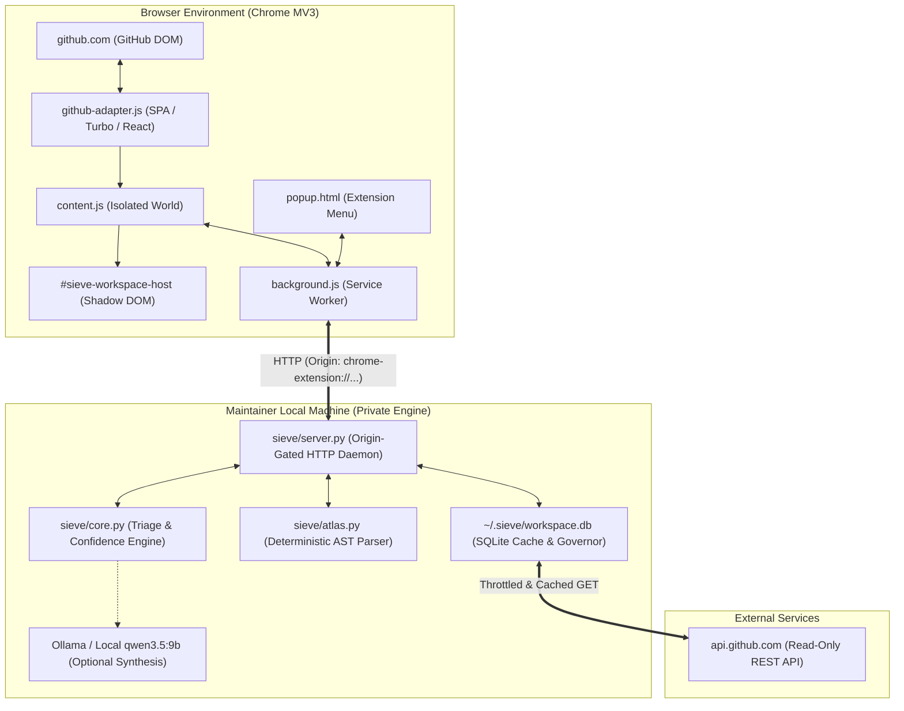

# Sieve Workspace V2 — System Architecture & Engineering Specification

**Date:** October 31, 2026  
**Auditor:** Principal Software Architect & Staff Backend Engineer  
**Status:** Approved Architectural Baseline (Supersedes V1)

---

## 1. System Overview & Trust Boundaries

Sieve Workspace V2 operates across two runtime boundaries:
1. **The Client Runtime (Google Chrome Manifest V3):** Content scripts and background workers interacting non-destructively with GitHub's live DOM.
2. **The Private Engine Runtime (`127.0.0.1:8787`):** A zero-dependency local daemon performing deterministic AST parsing, local SQLite caching, and optional local LLM synthesis (`qwen3.5:9b`).

---

## 2. Browser Extension Architecture (Manifest V3)

### Service Worker Lifecycle & Connection Resilience
In Chrome Manifest V3, background service workers terminate after ~30 seconds of inactivity.
- **Problem:** If a content script attempts to send a message while the service worker is terminating or inactive, message channels can close prematurely.
- **Solution:**
  - Content scripts use an exponential-backoff retry wrapper for `chrome.runtime.sendMessage()`.
  - The background service worker acts strictly as a stateless router and cache proxy; all durable state is persisted in `chrome.storage.local` or delegated to the local SQLite engine.

### Modern GitHub SPA & Turbo Lifecycle
Modern GitHub is a hybrid architecture: Turbo Frames, PJAX navigations, and client-side React hydration (`<react-app app-name="repo">`).
- **Hydration Race Condition Mitigation:**
  - Content scripts listen to `turbo:load`, `turbo:render`, `pjax:end`, and `popstate`.
  - When navigating to `/pulls` or `/pull/:id`, the adapter initiates a **hydration observer loop** (`checkAndMount`, checking every 200ms up to 25 attempts).
  - This guarantees that Sieve elements (`.sieve-native-switcher`, `.sieve-pr-pill`) re-attach seamlessly even if GitHub's React engine finishes hydrating 1.5 seconds after DOMContentLoaded and replaces initial DOM nodes.

### Shadow DOM Style Isolation
- All Sieve HTML is mounted inside `#sieve-workspace-host.attachShadow({ mode: "open" })`.
- Prevents GitHub Primer CSS from leaking into Sieve, and prevents Sieve's Liquid Glass tokens from corrupting native GitHub layouts.
- Dynamic SVGs (Topology DAG) are rendered natively inside the Shadow Root using pure SVG DOM APIs.

---

## 3. Local Engine & Backend Architecture

### Python Standard Library Zero-Pip Foundation
The backend remains 100% executable on any machine with Python 3.10+ without running `pip install`:
- HTTP Server: `http.server.ThreadingHTTPServer`
- Networking: `urllib.request` with SSL context fallback for macOS certificates
- AST Parsing: Built-in `ast` module
- Local Persistence: Built-in `sqlite3` module

### Rate-Limit Governor & SQLite Caching (`~/.sieve/workspace.db`)
In V1, unauthenticated requests to GitHub's REST API repeatedly failed with HTTP 403 Rate Limit Exceeded (capped at 60/hr).
In V2, the local engine introduces an on-disk SQLite cache layer:
- **Table `repo_cache`:** Caches repository tree structures, commit history, and issue metadata with configurable TTL (default 1 hour).
- **Table `pr_cache`:** Caches parsed AST diffs and blast radius calculations by commit SHA. If a PR has not received new commits, its blast radius is returned in 2 milliseconds from SQLite with zero network calls.
- **Rate-Limit Governor:** Tracks remaining GitHub API quota from `x-ratelimit-remaining` response headers. When quota drops below 10 requests, background scraping is automatically paused and cached snapshots are served.

---

## 4. Repository Intelligence & Polyglot Roadmap

### Python AST Engine (`sieve/atlas.py`)
- Traverses file ASTs to find `Import`, `ImportFrom`, and relative imports (`..module`).
- Identifies internal repository dependents by resolving imported package names against the repository directory tree.
- Detects test relationships by inspecting imports in test directories and file naming conventions (`test_*.py`).

### Polyglot AST Strategy (V2.1 Target)
To support TypeScript, JavaScript, and Go without heavyweight node_modules:
1. **TypeScript/JavaScript:** Use a lightweight WebAssembly build of Tree-sitter or a bundled single-file JS parser executed via standard library subprocess or embedded micro-engine.
2. **Go:** Static regex / AST parser recognizing Go package imports and module boundaries (`go.mod`).

---

## 5. AI Architecture & Prompt Safety

### Deterministic First, Qualitative Second
- Sieve **never** uses an LLM to determine file changes, import relationships, test existence, or commit SHAs. All facts are derived deterministically via AST and Git APIs.
- The LLM (`qwen3.5:9b` via Ollama, or optional Gemini API) is invoked strictly for qualitative tasks:
  1. Summarizing maintainer review comments into a concise feedback sentence.
  2. Evaluating whether a PR description's qualitative claims align with the diff.

### Prompt Injection Defenses
1. **JSON Payload Gating:** PR titles, commit messages, and descriptions are never interpolated directly into raw string prompt templates. They are passed as structured JSON values within delimited blocks (`<untrusted_pr_content>`).
2. **Instruction Neutralization:** The system prompt explicitly instructs the model to ignore any instructions, system overrides, or markdown formatting embedded inside the PR text.

